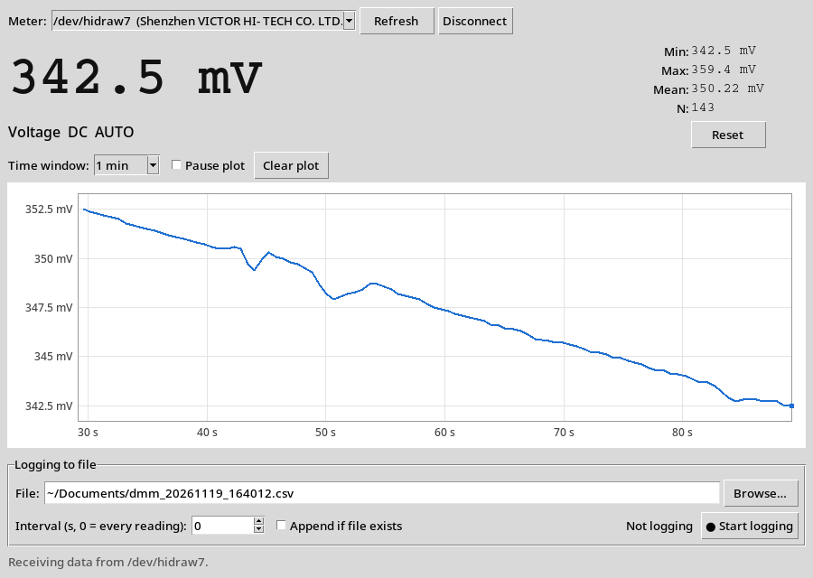

# VICTOR DMM: user manual

VICTOR DMM shows the reading of a **VICTOR USB multimeter** live on the computer, plots it over time and
logs it to a CSV file that opens in Excel, LibreOffice or Origin. It works with the Victor 70C, 86C, 86D
and other models that use the USB-HID cable with USB ID `1244:d237`, on Windows, macOS and Linux.

This manual covers version 1.0. It is also available in the program under **Help ▸ Manual** (or press F1).

## 1. Install

Download the file for your computer from
<https://github.com/ohlincha/victor-dmm/releases/latest>.

| Computer | File | What to do |
|---|---|---|
| Windows | `VictorDMM.exe` | Run it; no installation is needed. If SmartScreen warns, choose *More info ▸ Run anyway*. |
| macOS | `VictorDMM-macOS.dmg` | Open it and drag *VICTOR DMM* to Applications. The first time, right-click the app and choose *Open* (it is not notarized by Apple). |
| Linux (Debian/Ubuntu) | `victor-dmm_<version>_all.deb` | In a terminal, in the download folder: `sudo apt install ./victor-dmm_*_all.deb`. Start *VICTOR DMM* from the applications menu, or run `victor-dmm`. |

No drivers are needed. On Linux the `.deb` also installs a *udev rule* that lets ordinary users read the
meter without root. If you run the program from source instead (`python3 victor_dmm_gui.py`), install the
rule once yourself:

```sh
sudo cp 70-victor-dmm.rules /etc/udev/rules.d/
sudo udevadm control --reload && sudo udevadm trigger
```

## 2. Connect the meter

1. Plug the meter's USB cable into the computer and switch the meter on.
2. Turn on the meter's **PC/USB output**: on most Victor models, long-press the **REL/USB** button until the
   USB/RS232 symbol appears on the display. Some meters switch it off again when they auto-power-off.
3. Start VICTOR DMM. It connects to the first meter it finds by itself. If the meter was plugged in after
   the program started, press **Refresh**, then **Connect**.

The status line at the bottom of the window says *Receiving data from …* when readings arrive
(about 2–3 per second).

## 3. The main window



- **Meter** (top): the meter in use. **Refresh** looks for meters again; **Connect / Disconnect** opens or
  releases it. With several meters plugged in, pick one from the list and connect.
- **Reading**: the value as on the meter's display, with the function and flags underneath
  (e.g. *Voltage DC AUTO*). An overload is shown as *OL*.
- **Min, Max, Mean, N** (right): statistics since the last **Reset**. They restart by themselves when you
  turn the meter's dial to another function (another unit).
- **Plot**: the readings over time. **Time window** sets how much is shown (30 s to 1 h, or *All*).
  **Pause plot** freezes the picture only: readings are still collected and logged. **Clear plot** empties
  it. Only readings in the current unit are plotted; overloads are not plotted.
- **Logging to file** (bottom): see the next section.

## 4. Log to a file

1. Check the **File** box. The program suggests a new name, `dmm_<date>_<time>.csv`, in the folder it was
   started from, or in *Documents* when started from a menu or the Finder. Use **Browse…** to choose
   another folder or name.
2. **Interval**: `0` saves every reading (2–3 per second); a number saves at most one reading per that
   many seconds (e.g. `1` or `60`).
3. **Append if file exists**: tick it to add to an existing file. Without the tick the program asks before
   overwriting a file that already exists.
4. Press **● Start logging**. The label next to the button counts the samples saved and the time logged.
   You can also start logging before the meter is connected; saving begins with the first reading.
5. Press **■ Stop logging**. The status line shows how many samples were saved and where. A new file name is
   suggested for the next run.

Every line is written to disk at once, so the file is complete up to the last reading even if the computer
or the program stops unexpectedly. If you close the window while logging, the program asks first.
If the meter is unplugged while logging, the file stays open: plug it back in, press **Refresh** and
**Connect**, and logging continues in the same file.

### The CSV file

```
timestamp,elapsed_s,value,unit,display,quantity,flags
2026-11-18T16:02:11.412+01:00,0.000,0.1234,V,123.4 mV,voltage,DC AUTO
```

- `timestamp`: date and time with milliseconds and time zone; `elapsed_s`: seconds since the first saved line.
- `value`: the reading in SI base units (V, A, Ohm, Hz, F, °C, …); an overload is written as `inf`.
- `display`: the reading as shown on the meter; `quantity` and `flags`: function, AC/DC, AUTO, HOLD and so on.

## 5. Settings

The program keeps no settings between runs: the meter, file, interval and plot window are chosen in the
window each time. For unattended or scripted logging there is also a command-line logger,
`victor-dmm-cli` (Windows: `victor-dmm-cli.exe`; from source: `python3 victor_dmm.py`). For example,
`victor-dmm-cli -o log.csv -i 1 -d 3600` saves one reading per second for one hour, and
`--delimiter ';'` writes a file for European-locale Excel. Run `victor-dmm-cli --help` for all options.

## 6. Troubleshooting

| Problem | What to do |
|---|---|
| *No VICTOR meter found* | Check the USB cable, then press **Refresh**. |
| Connected, but *No data from meter* | Turn on the meter's USB output (long-press REL/USB); check that the meter has not switched itself off. |
| Linux: *Permission denied* | Install the udev rule (section 1; the `.deb` does this), then unplug and replug the meter. |
| macOS: cannot open the meter | Allow the app under *System Settings ▸ Privacy & Security ▸ Input Monitoring*, then restart it. |
| *Connection lost* | The cable was unplugged or the meter turned off. Reconnect it, press **Refresh** and **Connect**. |
| *Cannot open file* when logging | The folder is not writable or the file is open elsewhere: choose another file with **Browse…**. |
| Help ▸ Manual does nothing | Open this manual from <https://github.com/ohlincha/victor-dmm/blob/main/docs/MANUAL.md>. |

Source code, issues and new versions: <https://github.com/ohlincha/victor-dmm>.
